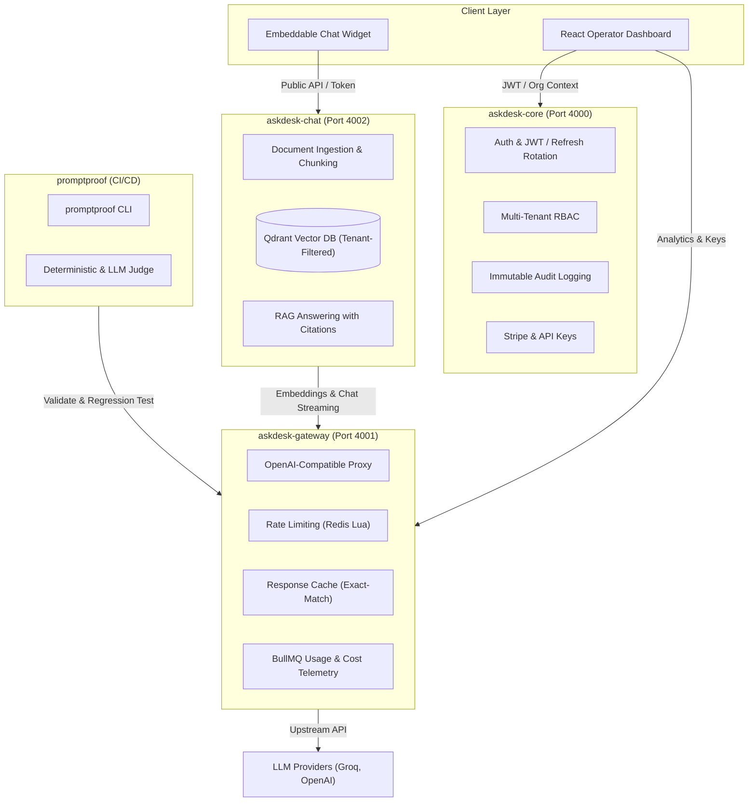

# AskDesk

> Intelligent customer support & AI gateway platform with tenant-isolated RAG, high-throughput LLM proxy, fine-grained RBAC, and automated prompt evaluation.

[](https://www.typescriptlang.org/)
[](https://nodejs.org/)
[](https://pnpm.io/)
[](LICENSE)

---

## 🎯 Overview

AskDesk is an enterprise customer support platform engineered to combine multi-tenant security with high-performance LLM infrastructure:

- **askdesk-core**: Identity, authentication (Argon2id + dual-token rotation), tenant isolation, role-based access control (RBAC), Stripe subscription billing, immutable audit logging, and API key management.
- **askdesk-gateway**: High-throughput OpenAI-compatible proxy with Redis token-bucket rate limiting, exact-match response caching, per-model cost accounting, and resilient provider failovers.
- **askdesk-chat**: Document ingestion pipeline, tenant-isolated vector retrieval with Qdrant, source citations, and chat engine.
- **promptproof**: Automated CI/CD prompt evaluation framework to detect drift and prevent regressions before production deployment.
- **askdesk-dashboard & widget**: Dense, operational operator dashboard and an embeddable customer-facing widget.

---

## 🏗 Architecture



---

## 📁 Repository Structure

```text
.
├── apps/
│   ├── askdesk-core/       # Core service: Auth, Users, Orgs, RBAC, Billing, Audit
│   ├── askdesk-gateway/    # AI Gateway: LLM proxy, rate limiting, cache, telemetry
│   ├── askdesk-chat/       # Ingestion worker, Qdrant RAG search, chat endpoints
│   └── askdesk-dashboard/  # Operator Dashboard (React + Vite + Tailwind)
├── packages/
│   ├── promptproof/        # CI/CD prompt evaluation CLI & test runner
│   └── widget/             # Embeddable vanilla TypeScript chat widget
├── .husky/                 # Git hooks (lint & typecheck pre-commit)
└── pnpm-workspace.yaml     # Monorepo workspace configuration
```

---

## 🚀 Quickstart

### Prerequisites

- **Node.js**: `>= 20.0.0` (v22.x recommended)
- **pnpm**: `>= 9.0.0`
- **MongoDB**: Local MongoDB instance running on port `27017` (Runs 100% natively without Docker required)

### 1. Install Dependencies

```bash
pnpm install
```

### 2. Configure Environment

Copy `.env.example` in each service:

```bash
cp apps/askdesk-core/.env.example apps/askdesk-core/.env
cp apps/askdesk-gateway/.env.example apps/askdesk-gateway/.env
cp apps/askdesk-chat/.env.example apps/askdesk-chat/.env
```

### 3. Run Development Services

```bash
# Start Core Control Plane (port 4000)
pnpm --filter askdesk-core dev

# Start AI Gateway (port 4001)
pnpm --filter askdesk-gateway dev

# Start Chat & RAG Retrieval Service (port 4002)
pnpm --filter askdesk-chat dev

# Start Operator Dashboard (port 5173)
pnpm --filter askdesk-dashboard dev
```

---

## 🧪 Testing & Verification

The repository contains comprehensive unit and integration tests across all microservices using Vitest:

```bash
# Run all tests across the monorepo (106 tests)
pnpm test

# Run tests with code coverage report
pnpm test:coverage

# Run prompt evaluation CI quality gate suite
pnpm promptproof

# Run multi-model comparison matrix (Fast vs Smart models)
pnpm promptproof:matrix

# Run strict type checking across all packages
pnpm typecheck

# Run ESLint across all packages
pnpm lint

# Check code formatting with Prettier
pnpm format:check
```

---

## 📡 API Reference

### Core Service (`http://127.0.0.1:4000`)

| Method | Endpoint                      | Description                                       |
| :----- | :---------------------------- | :------------------------------------------------ |
| `GET`  | `/health`                     | Service health status and uptime                  |
| `POST` | `/auth/register`              | Register user with Argon2id password hashing      |
| `POST` | `/auth/login`                 | Login and issue JWT access token + refresh cookie |
| `POST` | `/auth/refresh`               | Single-use rotation with family reuse revocation  |
| `POST` | `/auth/logout`                | Invalidate current refresh token                  |
| `POST` | `/orgs`                       | Create organization (assigns creator as `owner`)  |
| `GET`  | `/orgs/:orgId`                | Fetch organization details (RBAC isolated)        |
| `POST` | `/orgs/:orgId/invites`        | Invite user with role (`admin`, `member`)         |
| `POST` | `/orgs/:orgId/invites/accept` | Accept team invitation                            |
| `GET`  | `/orgs/:orgId/audit`          | Paginated immutable audit trail (admins only)     |
| `POST` | `/orgs/:orgId/api-keys`       | Generate secret-reveal-once API key               |
| `POST` | `/webhooks/stripe`            | Idempotent Stripe billing webhook handler         |

### Gateway Service (`http://127.0.0.1:4001`)

| Method | Endpoint                           | Description                                                    |
| :----- | :--------------------------------- | :------------------------------------------------------------- |
| `GET`  | `/health`                          | Gateway health probe                                           |
| `POST` | `/v1/chat/completions`             | OpenAI-compatible chat proxy with model aliases                |
| `POST` | `/v1/chat/completions?stream=true` | Server-Sent Events (SSE) streaming with abort handling         |
| `POST` | `/v1/embeddings`                   | OpenAI-compatible batch embeddings                             |
| `GET`  | `/v1/analytics`                    | Usage breakdown, token consumption, cost & latency percentiles |

### Chat & Retrieval Service (`http://127.0.0.1:4002`)

| Method   | Endpoint                              | Description                                                    |
| :------- | :------------------------------------ | :------------------------------------------------------------- |
| `GET`    | `/health`                             | Chat engine health probe                                       |
| `POST`   | `/orgs/:orgId/documents`              | Ingest document (PDF or Markdown) into tenant vector store     |
| `GET`    | `/orgs/:orgId/documents`              | List indexed documents and processing statuses                 |
| `DELETE` | `/orgs/:orgId/documents/:docId`       | Remove document and prune associated vectors from Qdrant       |
| `POST`   | `/chat/completions`                   | RAG chat completion with source citations & handover detection |
| `POST`   | `/chat/completions/stream`            | SSE streaming completion with inline citations                 |
| `GET`    | `/orgs/:orgId/conversations`          | List visitor conversation sessions                             |
| `GET`    | `/orgs/:orgId/conversations/:convoId` | Fetch message history for a conversation thread                |

---

## 🛡 Security & Design Principles

1. **Multi-Tenant Isolation**: Tenant boundaries are enforced at the database query level; requests are scoped by organization ID with zero shared leakage.
2. **Defensive Cryptography**: Passwords use Argon2id with OWASP-recommended memory parameters; API keys and refresh tokens store SHA-256 hashes only.
3. **Atomic Rate Limiting**: Token-bucket algorithm executed natively in Redis Lua to ensure concurrency safety without race conditions.
4. **Append-Only Auditing**: Audit entries cannot be mutated or deleted after insertion to maintain compliance integrity.
5. **Fail-Fast Architecture**: Zod validates all environment variables at process launch, aborting startup immediately if credentials or configurations are invalid.

---

## 📄 License

MIT
