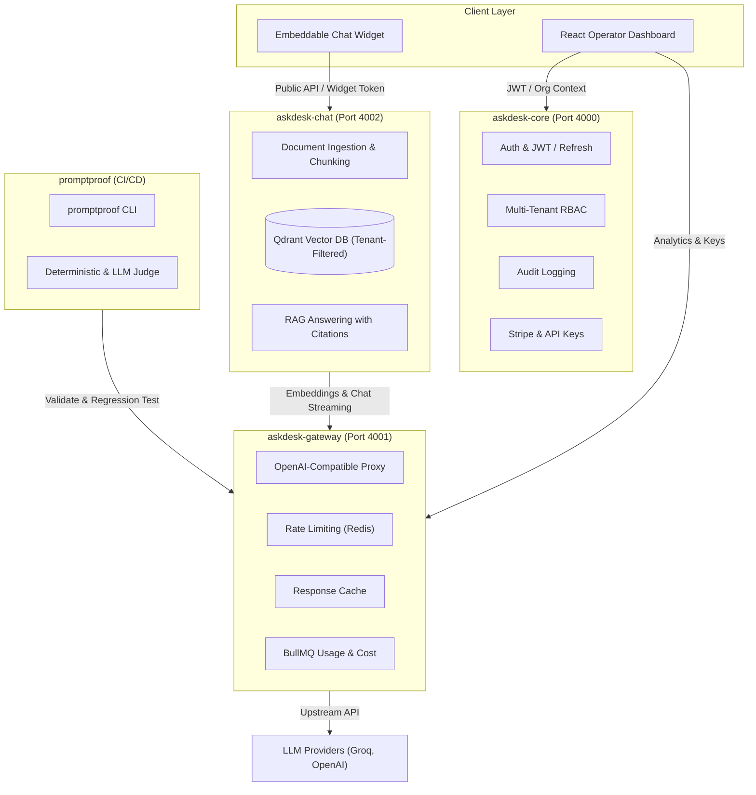

# AskDesk

> Intelligent technical support and customer helpdesk platform with tenant-isolated RAG, LLM proxy gateway, fine-grained RBAC, and automated prompt evaluation.

---

## 🎯 Problem Statement

Modern customer support teams struggle with:

1. **Slow resolution times**: Tier-1 support spends hours repeatedly answering common technical and policy questions.
2. **Context fragmentation**: Documentation is scattered across markdown, PDFs, wikis, and internal manuals without unified retrieval.
3. **Multi-tenant data leaks & security risks**: Generic chatbots mix or leak proprietary customer/organizational data.
4. **LLM costs and unreliability**: Direct API calls to LLM providers lack rate-limiting, semantic caching, token cost accounting, and fallbacks.
5. **Prompt drift & regression**: Prompts updated in production break quietly without CI/CD assertion gates.

**AskDesk** solves this by delivering an enterprise-ready customer support platform combining:

- **askdesk-core**: Auth, RBAC, organization tenants, Stripe billing, audit logging, and team management.
- **askdesk-gateway**: High-performance streaming LLM proxy with token-bucket rate limiting, Redis caching, cost accounting, and provider fallbacks.
- **askdesk-chat**: Document ingestion pipeline (PDF/text), chunking, Qdrant vector retrieval with strict tenant isolation, and citations.
- **promptproof**: Automated CI evaluation framework to score prompt outputs and block regressions before production deploys.
- **askdesk-dashboard & widget**: Quiet, dense, technical UI for operators and an embeddable customer-facing widget.

---

## 🏗 Architecture Overview



---

## 📁 Repository Structure

```text
.
├── apps/
│   ├── askdesk-core/       # Core service: Auth, Users, Orgs, RBAC, Billing, Audit
│   ├── askdesk-gateway/    # AI Gateway: LLM proxy, rate limiting, cache, telemetry
│   ├── askdesk-chat/       # Ingestion worker, Qdrant RAG search, chat endpoints
│   └── askdesk-dashboard/  # Dense, technical React dashboard (Vite + Tailwind)
├── packages/
│   ├── promptproof/        # CI/CD prompt evaluation CLI & runner
│   └── widget/             # Embeddable vanilla TS widget bundle
├── .husky/                 # Git hooks (pre-commit lint & commit-msg commitlint)
├── DECISIONS.md            # Technical decisions and architectural records
└── pnpm-workspace.yaml     # pnpm workspace monorepo definition
```

---

## 🚀 Quickstart

### Prerequisites

- **Node.js**: `>= 20.0.0` (v22.x recommended)
- **pnpm**: `>= 9.0.0`
- **MongoDB**: Local MongoDB instance running on port `27017` (No Docker required)

### 1. Install Dependencies

```bash
pnpm install
```

### 2. Configure Environment

Copy `.env.example` in `apps/askdesk-core`:

```bash
cp apps/askdesk-core/.env.example apps/askdesk-core/.env
```

Default configuration runs out of the box with `HOST=127.0.0.1`, `PORT=4000`, and `MONGODB_URI=mongodb://127.0.0.1:27017/askdesk_core`.

### 3. Start Development Server

```bash
# Start askdesk-core dev server with hot reload
pnpm dev:core
```

Output:

```text
[askdesk-core] Connected to MongoDB at mongodb://127.0.0.1:27017/askdesk_core
[askdesk-core] Server running at http://127.0.0.1:4000 in development mode
```

---

## 🧪 Testing Guide

### Automated Vitest Suite

```bash
# Run all unit and integration tests across the workspace
pnpm test

# Run tests with V8 code coverage report
pnpm test:coverage

# Run tests in interactive watch mode
pnpm --filter askdesk-core test:watch
```

### Manual Testing & Route Verification

1. **Verify Health Route**:

   ```bash
   curl http://127.0.0.1:4000/health
   ```

   **Expected Response (HTTP 200 OK):**

   ```json
   {
     "status": "ok",
     "service": "askdesk-core",
     "uptime": 14.52,
     "timestamp": "2026-10-17T05:22:00.000Z"
   }
   ```

2. **Register a New User**:

   ```bash
   curl -X POST http://127.0.0.1:4000/auth/register \
     -H "Content-Type: application/json" \
     -d '{"email": "alex@example.com", "password": "SecureP@ssword123!", "name": "Alex"}'
   ```

   **Expected Response (HTTP 201 Created):**

   ```json
   {
     "message": "User registered successfully",
     "user": {
       "id": "67b0...",
       "email": "alex@example.com",
       "name": "Alex",
       "createdAt": "2026-10-17T05:30:00.000Z"
     }
   }
   ```

3. **Verify Duplicate Email Handling**:
   Repeat the same curl command above:
   **Expected Response (HTTP 409 Conflict):**
   ```json
   {
     "error": "Conflict",
     "message": "An account with this email address already exists"
   }
   ```

---

| Phase                        | Days       | Description                                                                     | Status                         |
| ---------------------------- | ---------- | ------------------------------------------------------------------------------- | ------------------------------ |
| **Phase 1: askdesk-core**    | Days 1–10  | Fastify foundation, Auth, Users, Orgs, RBAC, Audit, Stripe Billing, API Keys    | 🟢 Completed (Days 1–10 Done)  |
| **Phase 2: askdesk-gateway** | Days 11–20 | Streaming proxy, token-bucket limiter, response cache, cost tracking, analytics | 🟢 Completed (Days 11–20 Done) |
| **Phase 3: askdesk-chat**    | Days 21–33 | Ingestion, chunking, Qdrant tenant retrieval, citations, UI widget & dashboard  | ⚪ Next Phase                  |
| **Phase 4: promptproof**     | Days 34–40 | CLI eval framework, deterministic & LLM assertions, PR regressions              | ⚪ Pending                     |
| **Phase 5: Polish**          | Days 41–45 | Multi-service orchestration, security hardening, final docs                     | ⚪ Pending                     |

---

## 📜 Technical Decisions

All architectural decisions and tradeoffs are logged in [DECISIONS.md](file:///c:/Users/shivk/Downloads/askDesk/DECISIONS.md).

---

## 🛡 License

MIT
