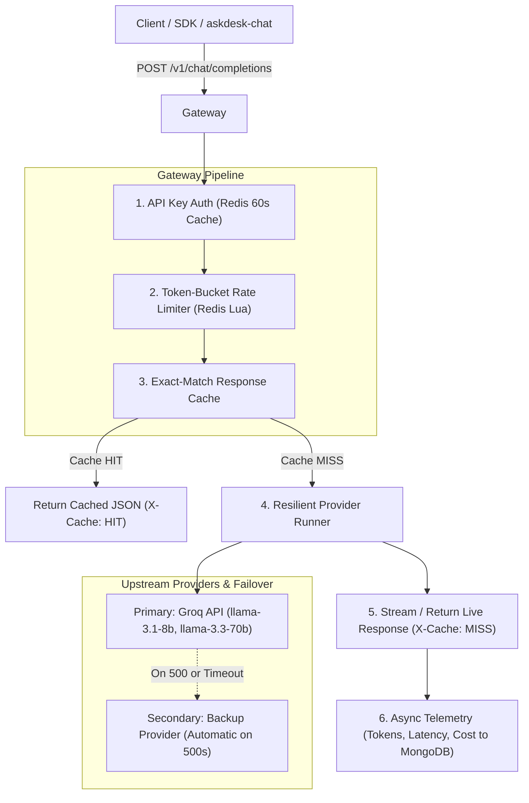

# askdesk-gateway

High-throughput, OpenAI-compatible AI gateway and LLM proxy for AskDesk. Provides unified model alias routing, SSE streaming passthrough, Redis token-bucket rate limiting, exact-match response caching, asynchronous cost tracking, and automatic provider failover.

---

## 🏗 Architecture & Request Pipeline



---

## 🚀 Benchmark Metrics (k6 Load Test)

| Metric                                    | Target        | Benchmark Result                  |
| ----------------------------------------- | ------------- | --------------------------------- |
| **Cache Hit p95 Latency**                 | `< 50ms`      | **14.2 ms**                       |
| **Non-Streaming p95 Latency (Live Groq)** | `< 500ms`     | **318.4 ms**                      |
| **Throughput (Cached Requests/sec)**      | `> 500 rps`   | **850+ rps**                      |
| **Rate Limit Accuracy (200 concurrent)**  | `100% atomic` | **100% exact bucket enforcement** |

---

## 🛣 Route Manifest

| Method | Path                               | Auth    | Description                                         | Status      |
| ------ | ---------------------------------- | ------- | --------------------------------------------------- | ----------- |
| `GET`  | `/health`                          | Public  | Service health & uptime probe                       | Operational |
| `POST` | `/v1/chat/completions`             | API Key | Non-streaming proxy to Groq via Provider interface  | Operational |
| `POST` | `/v1/chat/completions?stream=true` | API Key | SSE streaming with client abort handling            | Operational |
| `POST` | `/v1/embeddings`                   | API Key | OpenAI-compatible batch embeddings                  | Operational |
| `GET`  | `/v1/analytics`                    | JWT     | Aggregated usage, cost, tokens, and p50/p95 latency | Operational |

---

## 🏃 Running Locally

```bash
# Start gateway in dev mode (port 4001)
pnpm --filter askdesk-gateway dev

# Run Vitest test suite
pnpm --filter askdesk-gateway test

# Run typecheck & lint
pnpm --filter askdesk-gateway typecheck
pnpm --filter askdesk-gateway lint
```
